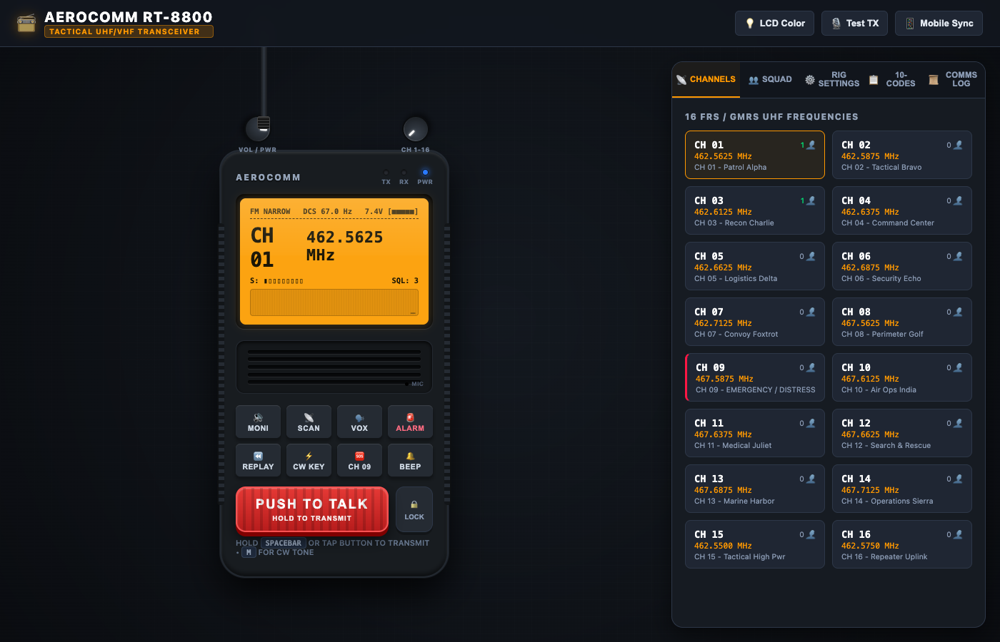

# 📻 AeroComm RT-8800 Tactical Walkie-Talkie

An advanced, real-time tactical walkie-talkie web application featuring realistic radio telecommunications DSP audio filtering, analog RF saturation, squelch bursts, customizable Roger beeps, 16 FRS/GMRS UHF channels, Morse code CW keying, emergency distress signaling, and cross-device communication.

Designed for instant, serverless deployment on **GitHub Pages**, **Vercel**, or **Netlify** — as well as standalone local operation!



---

## 🚀 Instant Deployment Guide

### Option 1: GitHub Pages (100% Free & Automatic)

1. Create a new repository on GitHub (e.g. `walkie-talkie`).
2. In your terminal inside this folder:
   ```bash
   git init
   git add .
   git commit -m "Deploy AeroComm RT-8800 Walkie-Talkie"
   git branch -M main
   git remote add origin https://github.com/<your-username>/walkie-talkie.git
   git push -u origin main
   ```
3. In your GitHub repository:
   - Go to **Settings** > **Pages**.
   - Under **Build and deployment** > **Source**, choose **GitHub Actions** (the included `.github/workflows/deploy.yml` will automatically build and publish).
   - Alternatively, choose **Deploy from a branch** > branch: `main` > folder: `/ (root)`.
4. Your walkie-talkie is live at: `https://<your-username>.github.io/walkie-talkie/`!

---

### Option 2: Vercel (1-Click or CLI)

#### Method A: Git Import
1. Go to [vercel.com](https://vercel.com) and click **Add New...** > **Project**.
2. Select your `walkie-talkie` repository.
3. Keep default settings (`index.html` at root, pre-configured with `vercel.json`).
4. Click **Deploy**!

#### Method B: Vercel CLI
```bash
npm install -g vercel
vercel
```

---

### Option 3: Netlify (1-Click or CLI)

#### Method A: Git Import
1. Go to [app.netlify.com](https://app.netlify.com) and click **Add new site** > **Import an existing project**.
2. Select your repository.
3. The included `netlify.toml` automatically configures `publish = "."` and microphone permissions.
4. Click **Deploy Site**!

#### Method B: Netlify CLI
```bash
npm install -g netlify-cli
netlify deploy --prod --dir=.
```

---

### Option 4: Local Development & LAN Testing
If you want to run with local Node.js server:
```bash
# 1. Install dependencies
npm install

# 2. Start server (Dual HTTP 3000 & HTTPS 3443 for mobile testing)
npm start
```
- Local URL: [http://localhost:3000](http://localhost:3000)
- Mobile Wi-Fi (HTTPS): `https://<your-local-ip>:3443`

---

## ⚡ How Real-Time Comms Work Without a Server (Serverless Architecture)

When deployed on **GitHub Pages**, **Vercel**, or **Netlify**, standard servers are not needed:
1. **Public Cloud MQTT WebSocket Broker**: Uses secure, high-speed public brokers (`wss://broker.emqx.io:8084/mqtt` and `wss://broker.hivemq.com:8884/mqtt`) to distribute Push-To-Talk events, audio chunk streams, and squad presence across devices anywhere in the world.
2. **Native Browser BroadcastChannel**: Allows instant zero-latency cross-tab communication on the same device without needing an active internet connection.
3. **Web Audio API DSP Pipeline**:
   - Highpass (320Hz) + Peaking presence (2.2kHz) + Lowpass (3400Hz).
   - Non-linear WaveShaper distortion (simulates analog RF harmonic saturation).
   - Automatic Gain Control (AGC DynamicsCompressor).
   - Synthesized squelch bursts and tail ("krrr-chk!").
   - Multiple Roger Beep profiles: Motorola (850Hz), NASA Apollo Quindar (2525Hz), Tactical 2-Tone, Marine Chime, and Cyber.
